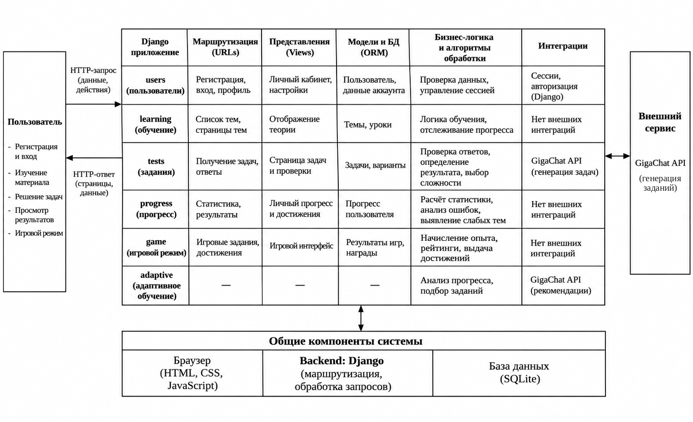
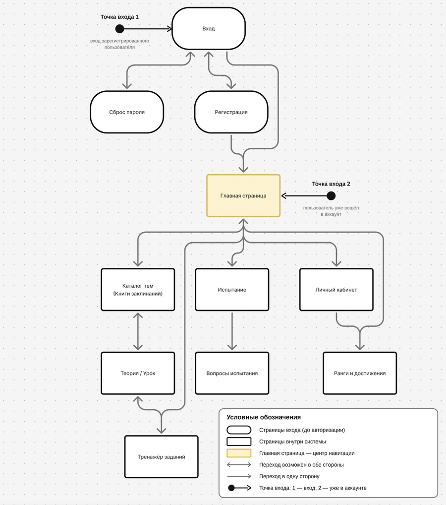
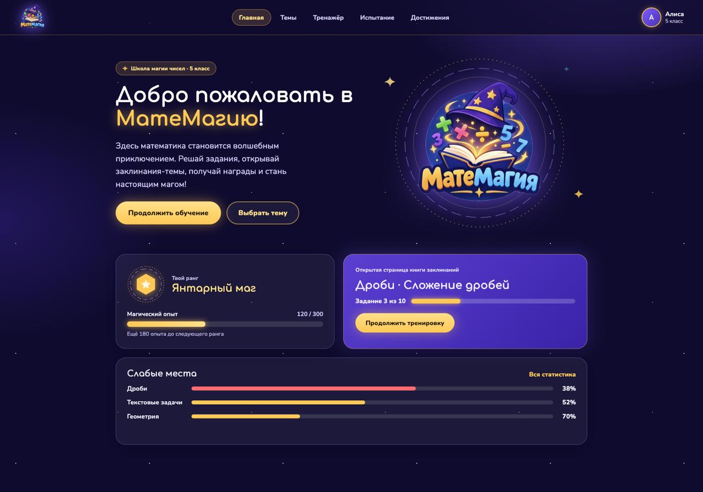
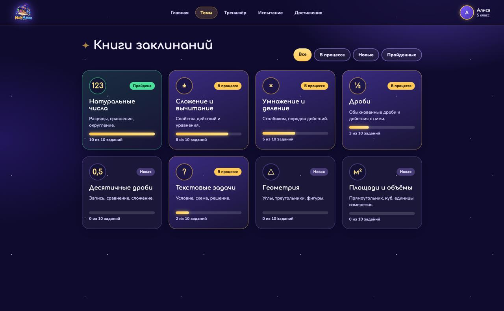
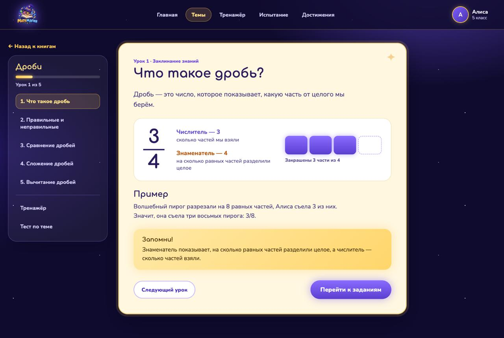
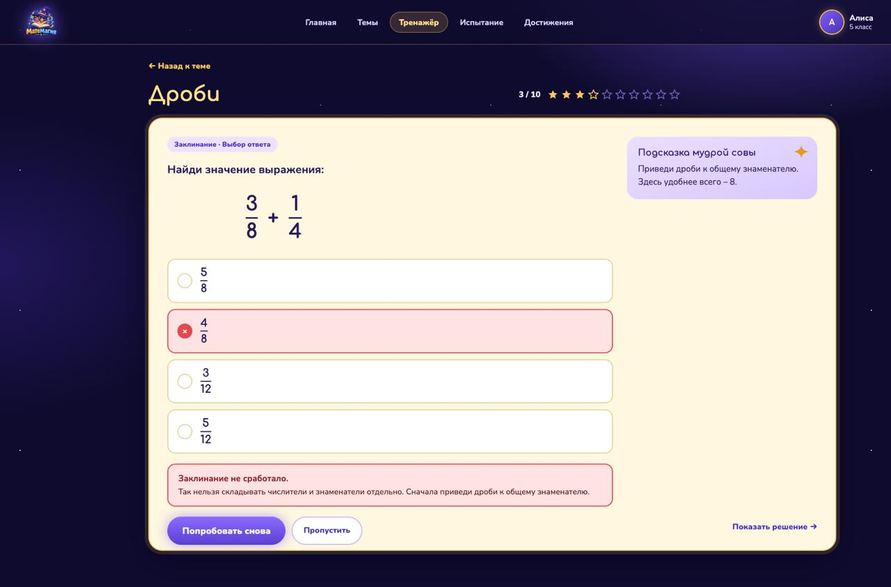
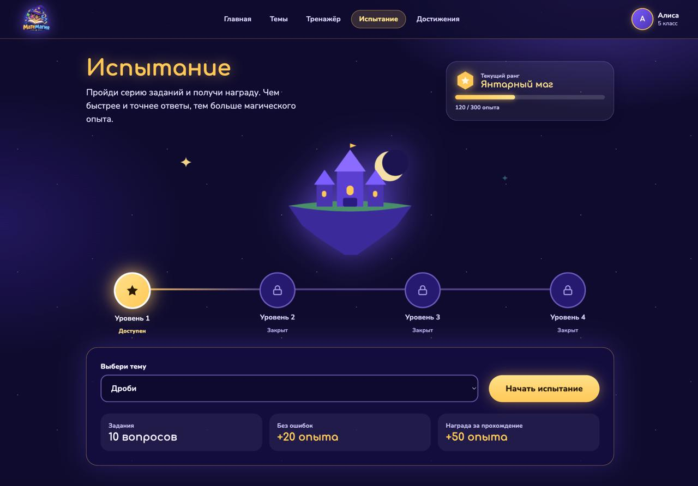
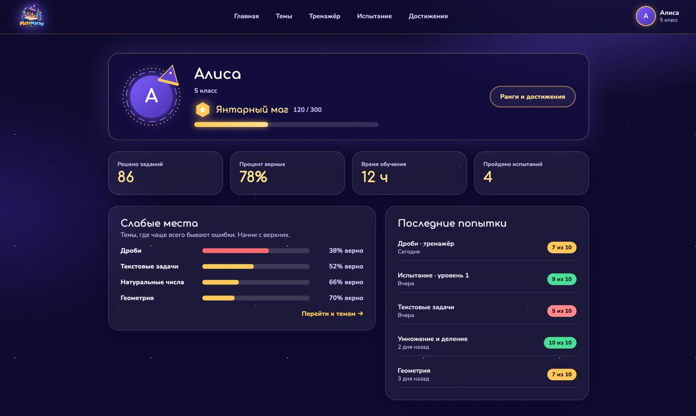
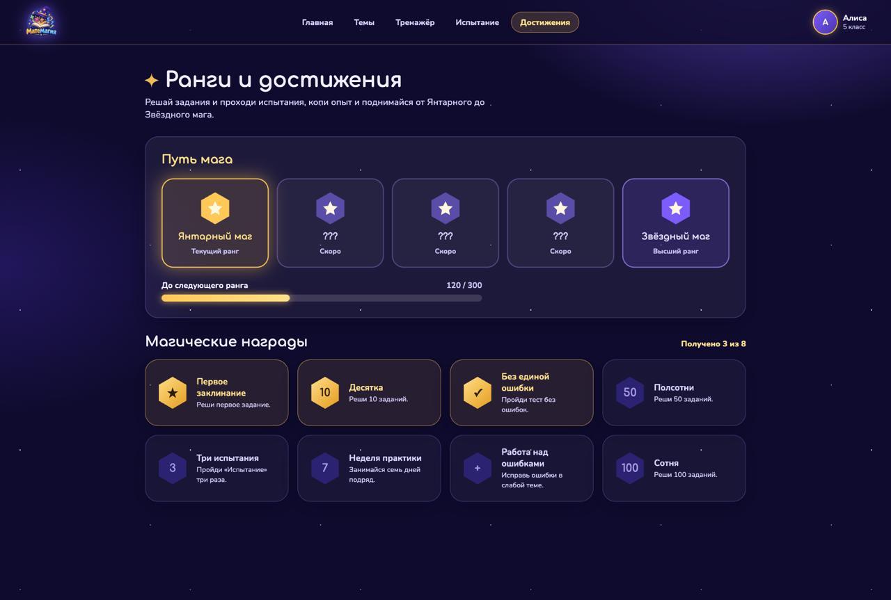
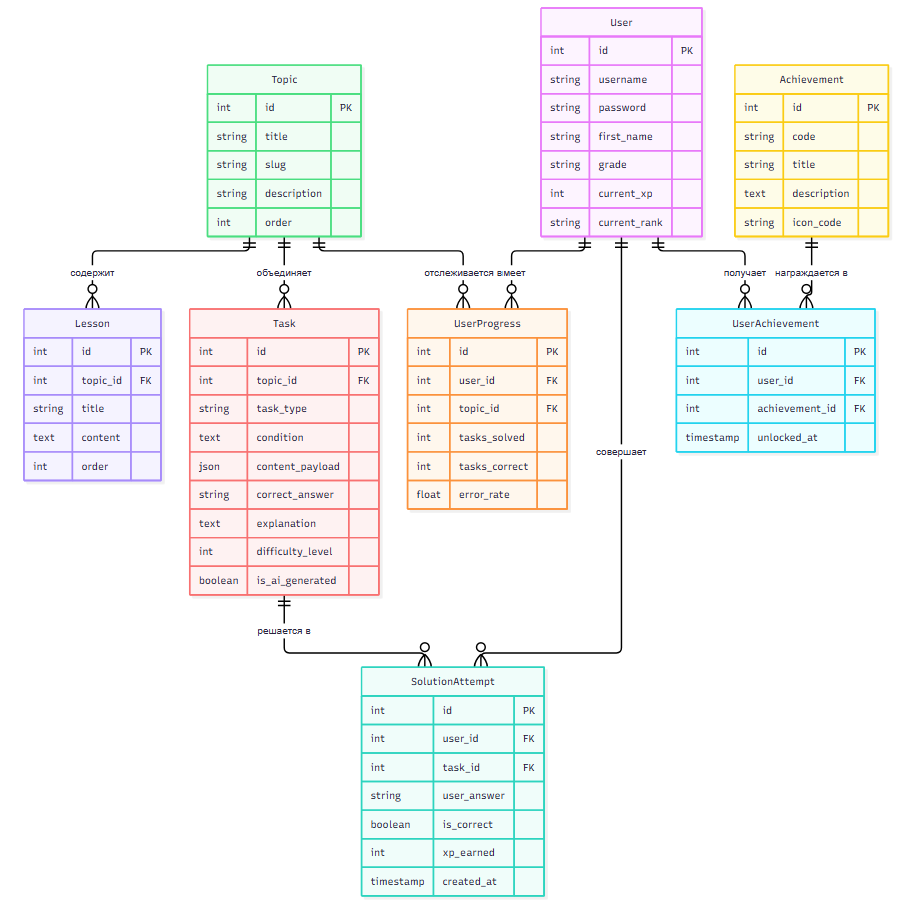

# МатеМагия: Документ проектирования

## 1. Проект архитектуры

### 1.1. Общие сведения
- **Название проекта:** МатеМагия
- **Тип системы:** Образовательное веб-приложение.
- **Назначение документа:** Описание архитектуры, технологического стека, основных компонентов и принципов их взаимодействия при реализации веб-приложения «МатеМагия».

Проект «МатеМагия» представляет собой интерактивный тренажер по математике для учащихся 5 класса. Приложение обеспечивает изучение математических тем, выполнение заданий, проверку решений, отслеживание образовательного прогресса и использование игровых элементов для повышения мотивации обучающихся.

Проектные решения основываются на спецификации требований системы.

### 1.2. Компоненты системы
- **Клиентский уровень** — Отображение интерфейсов регистрации и авторизации, выбора тем, теории, тренажёра заданий, личного кабинета и режима «Испытание», а также отправка HTTP-запросов на сервер.
- **Django URL** — Маршрутизация запросов к обработчикам.
- **Django Views** — Обработка запросов, вызов функциональных модулей, формирование ответов.
- **Приложение пользователей (`users`)** — Регистрация, авторизация, управление учётными записями.
- **Приложение обучения (`learning`)** — Выбор математических тем, отображение теоретических материалов.
- **Приложение заданий и тестов (`tests`)** — Выдача заданий, проверка ответов, отображение результатов и объяснений.
- **Приложение прогресса (`progress`)** — Сохранение результатов, статистика, анализ ошибок.
- **Приложение игрового режима (`game`)** — Режим «Испытание», начисление опыта, магические ранги, достижения.
- **Бизнес-логика (`Services`)** — Проверка ответов, расчёт успеваемости, выявление слабых мест, адаптация сложности, начисление игрового опыта.
- **Django ORM** — Взаимодействие с базой данных.
- **SQLite** — Хранение учётных записей, тем, теории, заданий, истории попыток, статистики, прогресса, опыта, рангов и достижений.
- **API GigaChat** — Внешний ИИ-сервис для генерации заданий и адаптивного обучения; при недоступности используются заранее подготовленные задания из базы данных.

### 1.3. Взаимодействие компонентов
1. Пользователь взаимодействует с интерфейсом через браузер.
2. Браузер отправляет HTTP-запросы на сервер Django.
3. Django URL маршрутизирует запрос к обработчику.
4. Django Views вызывает нужное Django-приложение (`users`, `learning`, `tests`, `progress`, `game`) и передаёт данные в бизнес-логику.
5. Бизнес-логика проверяет ответы, рассчитывает успеваемость, выявляет слабые места, адаптирует сложность и начисляет игровой опыт.
6. Django ORM выполняет чтение и запись данных в SQLite, которая служит основным источником данных для всех приложений.
7. При необходимости генерации заданий сервер отправляет запрос к API GigaChat и обрабатывает полученный ответ; при недоступности API задания берутся из базы данных.
8. Django Views формирует ответ, который возвращается в браузер и отображается пользователю.

### 1.4. Архитектурный подход
Веб-приложение «МатеМагия» построено на трехуровневой клиент-серверной архитектуре, включающей:
- **Клиентский уровень (Frontend)** — веб-интерфейс приложения, реализованный с использованием HTML, CSS и JavaScript. Обеспечивает взаимодействие обучающегося с системой через браузер.
- **Серверный уровень (Backend)** — серверное приложение на Django, отвечающее за обработку запросов пользователей, реализацию бизнес-логики и взаимодействие с другими компонентами системы.
- **Уровень хранения данных (Storage)** — реляционная база данных SQLite, предназначенная для хранения учетных записей пользователей, математических тем, заданий, истории решений и образовательного прогресса.

Дополнительно система взаимодействует с внешним ИИ-сервисом GigaChat для генерации математических заданий и адаптации их сложности. Доступ к приложению осуществляется через веб-браузер на компьютере, планшете или смартфоне. Разработка отдельных мобильного и десктопного приложений не предусматривается.

### 1.5. Организация серверной части
Серверная часть реализуется на языке Python с использованием фреймворка Django. Архитектура Django основана на паттерне Model-Template-View (MTV), концептуально близком к MVC. Для разделения функциональности серверное приложение организуется в виде независимых логических модулей (Django Apps): `users`, `learning`, `tests`, `progress`, `game`. Такое разделение позволяет разрабатывать и изменять отдельные функциональные части приложения независимо друг от друга, сохраняя общую структуру системы.

### 1.6. Взаимодействие с внешним ИИ-сервисом
Для автоматической генерации математических заданий и адаптации их сложности предусмотрена интеграция с внешним API GigaChat от Сбера. Обращение к ИИ-сервису выполняется серверной частью приложения. Сформированные задания передаются в подсистему заданий для последующего отображения обучающемуся. При недоступности внешнего API система использует заранее подготовленные задания, хранящиеся в базе данных SQLite.

### 1.7. Технологический стек

| Компонент | Технология | Назначение |
| :--- | :--- | :--- |
| Frontend | HTML5, CSS3, JavaScript | Создание интерфейса и взаимодействие с пользователем |
| Backend | Python 3.12, Django | Обработка запросов и реализация серверной логики |
| База данных | SQLite | Хранение данных приложения |
| Работа с БД | Django ORM | Взаимодействие серверной части с базой данных |
| Аутентификация | Django Authentication | Управление учетными записями и авторизацией |
| Администрирование | Django Admin | Управление данными приложения |
| ИИ-интеграция | GigaChat API | Генерация математических заданий |
| Контроль версий | Git, GitHub | Хранение исходного кода и совместная разработка |

### 1.8. Схема архитектуры



### 1.9. Описание блоков детальной архитектуры

#### 1.9.1. Приложение пользователей (`users`)
- **Маршруты (URLs):** `/register/`, `/login/`, `/logout/`, `/profile/` — адреса регистрации, входа, выхода и личного кабинета.
- **Представления (Views):** `RegisterView`, `LoginView`, `LogoutView`, `ProfileView` — принимают пользовательские запросы, организуют авторизацию и подготавливают данные профиля для отображения.
- **Формы (Forms):** `RegistrationForm` проверяет данные новой учетной записи; `ProfileForm` обрабатывает сведения профиля.
- **Модели (Models):** `User` хранит учетные данные и сведения обучающегося (учетную запись, статистику и игровой прогресс).
- **Шаблоны (Templates):** `register.html`, `login.html`, `profile.html` — страницы регистрации, входа и личного кабинета.
- **Сервисы (Services):** создание учетных записей, проверка учетных данных, управление сессиями и предоставление сведений профиля.
- **Взаимодействие:** другие приложения используют сведения об авторизованном пользователе для привязки решений, статистики и достижений к конкретной учетной записи.

#### 1.9.2. Приложение обучения (`learning`)
- **Маршруты (URLs):** `/topics/`, `/topics/<id>/`, `/theory/<id>/` — просмотр каталога тем, выбранной темы и теоретического материала.
- **Представления (Views):** `TopicListView`, `TopicDetailView`, `TheoryView` — получают сведения о темах и уроках для передачи в интерфейс.
- **Формы (Forms):** отдельные формы не предусмотрены; выбор темы выполняется переходом по ссылке или нажатием на карточку.
- **Модели (Models):** `Topic` описывает математическую тему; теоретические материалы представлены сущностью урока (`Lesson` / `learning_lesson`).
- **Шаблоны (Templates):** `topic_list.html`, `topic_detail.html`, `theory.html` — каталог тем, сведения о теме и страница теории.
- **Сервисы (Services):** выбор математической темы, получение связанных уроков, правил, формул и примеров.
- **Взаимодействие:** приложение заданий получает выбранную тему, а приложение прогресса предоставляет данные о результатах обучения по темам.

#### 1.9.3. Приложение заданий и тестов (`tests`)
- **Маршруты (URLs):** `/tasks/`, `/tasks/next/`, `/tasks/<id>/`, `/tasks/<id>/check/` — выбор задания, подбор следующего задания, просмотр условия и отправка ответа на проверку.
- **Представления (Views):** `TaskListView`, `TaskDetailView`, `CheckAnswerView` — организуют выдачу задания, прием ответа и получение результата проверки.
- **Формы (Forms):** `AnswerForm` принимает ответ в формате, соответствующем типу задания.
- **Модели (Models):** `Task` хранит условие, формат, сложность и правильный ответ; сведения о попытках решения хранятся в `progress_solutionattempt`.
- **Шаблоны (Templates):** `task_list.html`, `task.html`, `result.html` — список заданий, выполнение задания и результат проверки.
- **Сервисы (Services):** подбор задания по теме и типу, проверка допустимости введенного ответа, вызов алгоритма проверки и подготовка обратной связи.
- **Взаимодействие:** передает сведения о завершенных попытках приложению прогресса и обращается к сервису адаптивного обучения при подборе следующего задания.

#### 1.9.4. Приложение прогресса (`progress`)
- **Маршруты (URLs):** `/progress/`, `/progress/history/`, `/progress/errors/` — просмотр общей статистики, истории решений и проблемных тем.
- **Представления (Views):** `ProgressView`, `HistoryView`, `ErrorAnalysisView` — подготавливают данные о результатах обучения.
- **Формы (Forms):** отдельные формы не требуются.
- **Модели (Models):** `SolutionAttempt` (`progress_solutionattempt`) хранит попытки решения; `UserProgress` (`progress_userprogress`) — агрегированные показатели по математическим темам.
- **Шаблоны (Templates):** `progress.html`, `history.html`, `weak_topics.html` — статистика, история решений и анализ слабых мест.
- **Сервисы (Services):** учет результатов, расчет процента верных ответов, анализ ошибок и определение тем, требующих повторения.
- **Взаимодействие:** получает результаты работы с заданиями и игрового режима; передает историю попыток сервису адаптивного обучения.

#### 1.9.5. Приложение игрового режима (`game`)
- **Маршруты (URLs):** `/game/`, `/game/start/`, `/game/result/`, `/achievements/` — открытие режима «Испытание», запуск игровой сессии, просмотр результата и достижений.
- **Представления (Views):** `GameStartView`, `GameSessionView`, `GameResultView`, `AchievementsView` — организуют этапы игрового режима и отображение результатов.
- **Формы (Forms):** `AnswerForm` используется совместно с приложением заданий для отправки ответов.
- **Модели (Models):** справочник достижений (`Achievement`) и полученные пользователем достижения (`UserAchievement`). Сведения об опыте и текущем ранге связаны с учетной записью, состояние активного испытания хранится в сессии.
- **Шаблоны (Templates):** `game.html`, `game_result.html`, `achievements.html` — экран испытания, результат и достижения.
- **Сервисы (Services):** управление игровой сессией, начисление очков опыта, определение ранга и выдача достижений.
- **Взаимодействие:** использует приложение заданий для получения и проверки упражнений; передает результаты испытаний приложению прогресса.

#### 1.9.6. Сервис адаптивного обучения (`adaptive`)
- **Маршруты, представления и формы:** собственные страницы и маршруты не предусмотрены; сервис вызывается из серверной логики других приложений.
- **Данные:** использует сведения о заданиях, истории попыток и показателях успеваемости из существующих моделей.
- **Сервисы (Services):** определение сложности следующих заданий, подготовка запроса на генерацию, взаимодействие с API GigaChat и резервный выбор подготовленного задания из базы данных.
- **Взаимодействие:** получает историю решений из `progress`, передает параметры генерации внешнему GigaChat API, получает сгенерированное задание и возвращает его приложению `tests`. Если генерация недоступна, запрашивает заранее подготовленное задание через Django ORM.

#### 1.9.7. Общие компоненты системы
- **Корневая маршрутизация (`config/urls.py`):** объединяет адреса функциональных приложений и направляет HTTP-запросы к соответствующим представлениям.
- **Общий шаблон и статические ресурсы (`base.html`, `static`):** обеспечивают единую навигацию, оформление страниц, подключение CSS и JavaScript.
- **Бизнес-логика (`Services`):** реализует проверку ответов, анализ успеваемости, адаптацию сложности и начисление игрового опыта.
- **Django ORM:** выполняет операции с моделями и обеспечивает чтение и запись данных в SQLite.
- **База данных SQLite:** хранит учетные записи, математические темы, уроки, задания, попытки, статистику и достижения.
- **GigaChat API:** внешний сервис генерации заданий; непосредственное обращение к нему выполняет серверный компонент `adaptive`.

#### 1.9.8. Общая последовательность взаимодействия
1. Обучающийся выполняет действие в браузере и отправляет HTTP-запрос.
2. Маршрутизация Django URL выбирает представление соответствующего приложения.
3. Представление проверяет запрос и вызывает необходимую бизнес-логику.
4. Бизнес-логика получает или сохраняет данные через модели Django ORM и SQLite; при необходимости генерации задания обращается к сервису `adaptive`.
5. Сервис `adaptive` взаимодействует с GigaChat API либо выбирает резервное задание из базы данных.
6. Представление формирует ответ, а браузер отображает результат пользователю.

---

## 2. Проект интерфейса пользователя

### 2.1. Внешний вид системы

#### 2.1.1. Диаграмма переходов



#### 2.1.2. Авторизация / Вход в систему (`auth_login.html`)


- **Статичные элементы:**
  - Логотип веб-приложения «МатеМагия» (`app-logo`).
  - Слоган проекта: «Открой дверь в мир волшебной математики» (`auth-slogan`).
  - Текстовые заголовки и метки полей: «С возвращением, маг!», поля «Логин» (`username`, пример `alisa5`) и «Пароль» (`password`, плейсхолдер «Волшебное слово»).
- **Активные элементы:**
  - Вкладка-переключатель «Вход» (`tab-login`, активная) и «Регистрация» (`tab-register`, неактивная в шапке формы).
  - Кнопка подтверждения действия «Войти в мир магии» (`btn-submit-login`).
- **Интерактивные элементы:**
  - Поле ввода текста для логина (`id_username`).
  - Поле ввода пароля (`id_password`).
  - Интерактивные ссылки-кнопки восстановления доступа (`link-password-reset`, «Забыл пароль?») и регистрации нового аккаунта (`link-register`, «Зарегистрироваться»).

#### 2.1.3. Главная страница авторизованного пользователя (`dashboard_main.html`)



- **Статичные элементы:**
  - Верхняя навигационная панель (`header.main-navbar`) с пунктами меню («Главная», «Темы», «Тренажёр», «Испытание», «Достижения») и профилем пользователя (`user-profile-widget`: «Алиса, 5 класс»).
  - Приветственный блок (`welcome-banner`): заголовок «Добро пожаловать в МатеМагию!», описание и иллюстративный значок школы магии чисел.
  - Блок отображения текущего ранга (`widget-current-rank`: «Янтарный маг»), прогресс-бар магического опыта (`rank-progress-bar`) с подсказкой до следующего ранга.
  - Блок «Слабые места» (`widget-weak-spots`) с графиками прогресса по темам и переходом к статистике.
- **Активные элементы:**
  - Индикатор текущего урока/страницы книги заклинаний (`widget-active-lesson`: «Дроби · Сложение дробей», «Задание 3 из 10» с полосой прогресса).
- **Интерактивные элементы:**
  - Кнопка быстрого продолжения обучения (`btn-continue-learning`, «Продолжить обучение»).
  - Кнопка перехода к каталогу тем (`btn-select-topic`, «Выбрать тему»).
  - Кнопка возобновления прерванной тренировки (`btn-continue-workout`, «Продолжить тренировку»).
  - Ссылка-кнопка перехода к полной статистике (`link-full-stats`, «Вся статистика»).
  - Ссылки главного меню навигации (`nav-links`).

#### 2.1.4. Каталог тем / Книги заклинаний (`topic_catalog.html`)



- **Статичные элементы:**
  - Верхняя панель навигации и профиль пользователя.
  - Заголовок раздела «Книги заклинаний» (`page-title`) и подзаголовок с указателем класса.
  - Карточки математических тем (`topic-card`) с кратким описанием и индикаторами статуса («Пройдена», «В процессе», «Новая»).
- **Активные элементы:**
  - Фильтры списка (`filter-bar`) тем в виде кнопок-категорий (`filter-btn`: «Все», «В процессе», «Новые», «Пройденные»).
  - Визуальные индикаторы прогресса (`topic-progress-fill`: полосы заполнения и счетчики заданий) на карточках тем.
- **Интерактивные элементы:**
  - Кнопки фильтрации тем, изменяющие отображение каталога при клике.
  - Карточки тем, клик по которым открывает детальное содержание выбранной книги заклинаний.

#### 2.1.5. Просмотр теории / Урок (`theory_view.html`)



- **Статичные элементы:**
  - Верхняя навигация и профиль пользователя.
  - Индикатор текущего урока (`lesson-header`: «Урок 1 · Заклинание знаний»).
  - Основной текст теоретического материала (`theory-content`), визуальные схемы дробей, текстовые примеры и блок-подсказка «Запомни!».
- **Активные элементы:**
  - Боковая панель оглавления темы (`course-sidebar`) со списком уроков и разделов тренажера.
  - Индикатор прохождения уроков («Урок 1 из 5»).
- **Интерактивные элементы:**
  - Ссылка-кнопка возврата к списку тем (`link-back-topics`, «← Назад к книгам»).
  - Пункты бокового меню уроков (`sidebar-lesson-item`) для переключения между разделами теории.
  - Кнопка перехода к следующему уроку (`btn-next-lesson`, «Следующий урок»).
  - Кнопка перехода к практическим заданиям (`btn-go-to-tasks`, «Перейти к заданиям»).

#### 2.1.6. Интерфейс тренажера заданий (`task_trainer.html`)



- **Статичные элементы:**
  - Верхняя панель навигации.
  - Заголовок темы (`task-header`, «Дроби») и шапка задания («Заклинание · Выбор ответа»).
  - Условие математического выражения и блок (`owl-hint-box`) «Подсказка мудрой совы».
  - Индикатор выполнения в виде ряда звезд (`rating-stars-bar`).
- **Активные элементы:**
  - Варианты ответов в виде радиокнопок (`option-item`) с математическими дробями.
  - Цветовая индикация состояния ответа: неверный вариант выделен красным цветом с иконкой ошибки («×»).
  - Блок обратной связи (`feedback-panel`) системы с текстом ошибки и объяснения.
- **Интерактивные элементы:**
  - Кнопка повторной попытки решения (`btn-retry-task`, «Попробовать снова»).
  - Кнопка пропуска задания (`btn-skip-task`, «Пропустить»).
  - Кнопка запроса правильного решения (`btn-show-solution`, «Показать решение →»).
  - Интерактивные варианты ответов для выбора (`answer-option-input`).

#### 2.1.7. Игровой режим «Испытание» (`challenge_game.html`)



- **Статичные элементы:**
  - Навигационное меню и профиль пользователя.
  - Заголовок «Испытание» и описание правил режима.
  - Карточка текущего ранга (`challenge-rank-card`, «Янтарный маг») с полосой набора опыта.
  - Иллюстративный блок уровней испытания (`challenge-map`) со стилизованным замком и уровнями.
  - Информационные блоки параметров испытания (количество вопросов, условия и награда).
- **Активные и интерактивные элементы:**
  - Выпадающий список выбора математической темы (`challenge-topic-select`).
  - Большая акцентная кнопка запуска режима (`btn-start-challenge`, «Начать испытание»).
  - Интерактивные узлы уровней на карте испытаний (`challenge-node-level`).

#### 2.1.8. Личный кабинет и статистика (`profile_stats.html`)



- **Статичные элементы:**
  - Шапка сайта с навигацией.
  - Профильный блок ученика (`user-profile-card`: аватар, имя, класс, текущий ранг и шкала опыта).
  - Карточки сводных показателей (`stats-grid`: решено заданий, процент верных, время обучения, пройдено испытаний).
  - Блок «Слабые места» (`weak-spots-section`) со списком тем и прогресс-барами ошибок.
  - Блок «Последние попытки» (`recent-attempts-section`) со списком недавней активности.
- **Активные элементы:**
  - Полосы визуализации уровня ошибок в блоке «Слабые места» (`progress-bar-danger`).
  - Статусные бейджи в блоке «Последние попытки» (`score-badge-success`) с результатами выполнения.
- **Интерактивные элементы:**
  - Кнопка перехода (`btn-ranks-achievements`) к системе рангов и достижений («Ранги и достижения»).
  - Кнопка-ссылка перехода из слабых мест к изучению тем (`link-fix-weak-spots`, «Перейти к темам →»).

#### 2.1.9. Ранги и достижения (`achievements_list.html`)



- **Статичные элементы:**
  - Верхняя навигация.
  - Заголовок «Ранги и достижения» с описанием условий получения опыта.
  - Блок «Путь мага» (`ranks-roadmap`) со шкалой прогресса опыта и карточками рангов.
  - Заголовок секции наград «Магические награды» (`achievements-counter`) со счетчиком полученных наград.
  - Сетка карточек достижений (`achievements-grid`) с описанием условий их получения.
- **Активные элементы:**
  - Индикатор прогресс-бара до следующего ранга (`rank-progress-fill`).
  - Визуальное разделение карточек на разблокированные (`achievement-card.unlocked`) и заблокированные (`achievement-card.locked`).
- **Интерактивные элементы:**
  - Карточки достижений и рангов (`achievement-card`) — интерактив при наведении / клике для просмотра подробностей.

---

## 3. Основные структуры данных

### 3.1. Структура БД
База данных веб-приложения «МатеМагия» реализуется в реляционной СУБД SQLite и управляется посредством Django ORM. Архитектура базы данных состоит из 8 ключевых таблиц:



#### 3.1.1. Таблица `users_user` (Пользователи / Обучающиеся)
Расширяет стандартную модель пользователей Django (`AbstractUser`). Хранит учетные данные, текущий ранг и накопленный магический опыт.

| Имя поля | Тип данных | Ограничения | Описание |
| :--- | :--- | :--- | :--- |
| `id` | INTEGER | PRIMARY KEY, AUTOINCREMENT | Уникальный идентификатор пользователя |
| `username` | VARCHAR(150) | UNIQUE, NOT NULL | Логин пользователя для входа |
| `password` | VARCHAR(128) | NOT NULL | Хеш пароля (PBKDF2 / Django Security) |
| `first_name` | VARCHAR(150) | NOT NULL | Имя обучающегося (например, «Алиса») |
| `grade` | VARCHAR(20) | DEFAULT '5 класс' | Учебный класс |
| `current_xp` | INTEGER | DEFAULT 0 | Накопленные очки магического опыта |
| `current_rank` | VARCHAR(50) | DEFAULT 'Янтарный маг' | Текущий магический ранг пользователя |
| `is_staff` | BOOLEAN | DEFAULT FALSE | Флаг прав администратора (Django Admin) |
| `date_joined` | DATETIME | NOT NULL | Дата и время регистрации |

#### 3.1.2. Таблица `learning_topic` (Математические темы / Книги заклинаний)
Хранит учебные разделы математики 5 класса.

| Имя поля | Тип данных | Ограничения | Описание |
| :--- | :--- | :--- | :--- |
| `id` | INTEGER | PRIMARY KEY, AUTOINCREMENT | Уникальный идентификатор темы |
| `title` | VARCHAR(200) | NOT NULL | Название темы (например, «Дроби») |
| `slug` | VARCHAR(200) | UNIQUE, NOT NULL | ЧПУ-идентификатор для URL |
| `description` | TEXT | NULL | Краткое описание содержания темы |
| `order` | INTEGER | DEFAULT 0 | Порядок отображения в каталоге |

#### 3.1.3. Таблица `learning_lesson` (Теоретические материалы / Уроки)
Содержит обучающие статьи, правила и формулы по темам.

| Имя поля | Тип данных | Ограничения | Описание |
| :--- | :--- | :--- | :--- |
| `id` | INTEGER | PRIMARY KEY, AUTOINCREMENT | Идентификатор урока |
| `topic_id` | INTEGER | FOREIGN KEY (`learning_topic.id`), NOT NULL | Ссылка на математическую тему (ON DELETE CASCADE) |
| `title` | VARCHAR(200) | NOT NULL | Заголовок урока («Что такое дробь?») |
| `content` | TEXT | NOT NULL | Текст теории с HTML/Markdown разметкой |
| `order` | INTEGER | DEFAULT 1 | Номер урока внутри темы |

#### 3.1.4. Таблица `tasks_task` (Задания / Упражнения)
Содержит математические задачи всех поддерживаемых форматов (выбор ответа, ввод числа, сопоставление, правда/ложь, порядок действий).

| Имя поля | Тип данных | Ограничения | Описание |
| :--- | :--- | :--- | :--- |
| `id` | INTEGER | PRIMARY KEY, AUTOINCREMENT | Идентификатор задачи |
| `topic_id` | INTEGER | FOREIGN KEY (`learning_topic.id`), NOT NULL | Ссылка на тему |
| `task_type` | VARCHAR(30) | NOT NULL | Тип задачи (`choice`, `input`, `matching`, `boolean`, `ordering`) |
| `condition` | TEXT | NOT NULL | Текст условия задачи |
| `content_payload` | JSON/TEXT | NULL | Варианты ответов, пары или элементы для сортировки (в формате JSON) |
| `correct_answer` | TEXT | NOT NULL | Эталонный правильный ответ |
| `explanation` | TEXT | NULL | Объяснение решения при ошибке |
| `difficulty_level` | INTEGER | DEFAULT 1 | Уровень сложности (от 1 до 3) |
| `is_ai_generated` | BOOLEAN | DEFAULT FALSE | Признак генерации через API GigaChat |

#### 3.1.5. Таблица `progress_solutionattempt` (История решений)
Фиксирует каждую попытку решения задачи обучающимся.

| Имя поля | Тип данных | Ограничения | Описание |
| :--- | :--- | :--- | :--- |
| `id` | INTEGER | PRIMARY KEY, AUTOINCREMENT | Идентификатор попытки |
| `user_id` | INTEGER | FOREIGN KEY (`users_user.id`), NOT NULL | Ссылка на пользователя |
| `task_id` | INTEGER | FOREIGN KEY (`tasks_task.id`), NOT NULL | Ссылка на задачу |
| `user_answer` | TEXT | NOT NULL | Ответ, переданный пользователем |
| `is_correct` | BOOLEAN | NOT NULL | Результат проверки (`True`/`False`) |
| `xp_earned` | INTEGER | DEFAULT 0 | Начисленные очки опыта |
| `created_at` | DATETIME | NOT NULL | Дата и время совершения попытки |

#### 3.1.6. Таблица `progress_userprogress` (Агрегированный прогресс по темам)
Агрегированная таблица для оперативного расчета успеваемости и быстрого выявления слабых мест.

| Имя поля | Тип данных | Ограничения | Описание |
| :--- | :--- | :--- | :--- |
| `id` | INTEGER | PRIMARY KEY, AUTOINCREMENT | Идентификатор записи |
| `user_id` | INTEGER | FOREIGN KEY (`users_user.id`), NOT NULL | Ссылка на пользователя |
| `topic_id` | INTEGER | FOREIGN KEY (`learning_topic.id`), NOT NULL | Ссылка на тему |
| `tasks_solved` | INTEGER | DEFAULT 0 | Всего решено заданий по теме |
| `tasks_correct` | INTEGER | DEFAULT 0 | Количество верных ответов |
| `error_rate` | FLOAT | DEFAULT 0.0 | Процент ошибок (используется для выявления слабых мест) |

#### 3.1.7. Таблица `game_achievement` (Справочник достижений)
Справочник всех возможных игровых наград и ачивок.

| Имя поля | Тип данных | Ограничения | Описание |
| :--- | :--- | :--- | :--- |
| `id` | INTEGER | PRIMARY KEY, AUTOINCREMENT | Идентификатор достижения |
| `code` | VARCHAR(50) | UNIQUE, NOT NULL | Код ачивки (`first_task`, `no_errors`, `century`) |
| `title` | VARCHAR(100) | NOT NULL | Название («Первое заклинание») |
| `description` | TEXT | NOT NULL | Условие получения («Реши первое задание») |
| `icon_code` | VARCHAR(50) | NOT NULL | Код иконки для отображения в UI |

#### 3.1.8. Таблица `game_userachievement` (Полученные достижения пользователей)
Связывающая таблица «многие-ко-многим», фиксирующая разблокированные пользователем награды.

| Имя поля | Тип данных | Ограничения | Описание |
| :--- | :--- | :--- | :--- |
| `id` | INTEGER | PRIMARY KEY, AUTOINCREMENT | Идентификатор записи |
| `user_id` | INTEGER | FOREIGN KEY (`users_user.id`), NOT NULL | Ссылка на пользователя |
| `achievement_id` | INTEGER | FOREIGN KEY (`game_achievement.id`), NOT NULL | Ссылка на полученное достижение |
| `unlocked_at` | DATETIME | NOT NULL | Дата и время разблокировки достижения |

### 3.2. Структура конфигурационных файлов

1. Создайте файл `.env` в корне проекта (файл хранится только на сервере и в Git не добавляется):

```env
DEBUG=True                                # Режим отладки: True — для разработки, False — для продакшена
SECRET_KEY='your-secret-key-here'         # Секретный ключ Django для подписи сессий и защиты данных
ALLOWED_HOSTS='localhost,127.0.0.1'       # Адреса и домены, с которых разрешён доступ к приложению
GIGACHAT_AUTH_KEY='your-gigachat-key'     # Ключ авторизации GigaChat API (если пустой — только задачи из БД)
GIGACHAT_SCOPE='GIGACHAT_API_PERS'        # Область доступа GigaChat API
GIGACHAT_TIMEOUT=10                       # Максимальное время ожидания ответа GigaChat в секундах
```

2. Игровые параметры в файле `config/settings.py`:

```python
BASE_XP = 10                              # Базовые очки опыта за верный ответ
DIFFICULTY_COEF = {1: 1.0, 2: 1.5, 3: 2.0}  # Коэффициент опыта для сложности 1, 2 и 3
STREAK_MIN = 3                            # Сколько верных ответов подряд нужно для бонуса за серию
STREAK_BONUS_XP = 5                       # Бонусные очки опыта за серию верных ответов
RANK_THRESHOLDS = [(0, 'Янтарный маг'), ..., (N, 'Звёздный маг')]  # Пороги опыта для магических рангов
CHALLENGE_TASKS_COUNT = 10                # Число заданий в режиме «Испытание»
CHALLENGE_SUCCESS_PERCENT = 60            # Процент верных ответов (0–100) для прохождения испытания
CHALLENGE_BONUS_XP = 30                   # Бонусные очки опыта за успешное прохождение испытания
```

3. Перезапустите сервер, чтобы изменения вступили в силу:

```bash
python manage.py runserver 0.0.0.0:8000
```

### 3.3. Структура данных для работы с GigaChat

#### 3.3.1. Входные данные генерации

| Поле | Тип | Назначение |
| :--- | :--- | :--- |
| `topic_id` | INTEGER | Идентификатор математической темы в таблице `learning_topic` |
| `topic_title` | STRING | Название темы, используемое при составлении запроса к ИИ |
| `grade` | INTEGER | Класс обучения; для проекта используется значение `5` |
| `difficulty_level` | INTEGER | Уровень сложности, определенный алгоритмом адаптации |
| `task_type` | STRING | Формат задания: `choice`, `input`, `matching`, `boolean` или `ordering` |

Пример внутренней структуры параметров генерации:

```json
{
  "topic_id": 3,
  "topic_title": "Обыкновенные дроби",
  "grade": 5,
  "difficulty_level": 2,
  "task_type": "choice"
}
```

#### 3.3.2. Выходные данные генерации

| Поле | Тип | Назначение |
| :--- | :--- | :--- |
| `task_type` | STRING | Тип сформированного задания |
| `condition` | STRING | Текст условия задания |
| `content_payload` | JSON / NULL | Дополнительные данные формата: варианты ответа, пары или элементы для упорядочивания |
| `correct_answer` | STRING | Эталонный ответ, используемый серверной проверкой |
| `explanation` | STRING | Объяснение правильного решения |
| `difficulty_level` | INTEGER | Сложность сформированного задания |

Пример нормализованного результата для задания с выбором ответа:

```json
{
  "task_type": "choice",
  "condition": "Чему равна сумма 1/4 + 2/4?",
  "content_payload": {
    "options": ["1/4", "2/4", "3/4", "4/4"]
  },
  "correct_answer": "3/4",
  "explanation": "При одинаковых знаменателях складываются числители: 1 + 2 = 3.",
  "difficulty_level": 2
}
```

#### 3.3.3. Проверка результата и сохранение
- Сервис проверяет наличие обязательных полей, допустимость `task_type` и соответствие сложности параметрам запроса.
- Для задания с выбором ответа проверяется наличие эталонного ответа среди предложенных вариантов; для остальных форматов используется проверка структуры соответствующего типа.
- При успешной проверке задание передается приложению `tests` и сохраняется через Django ORM в таблицу `tasks_task` с `is_ai_generated = True`.
- Правильный ответ и служебное объяснение не передаются обучающемуся до завершения проверки его решения.

#### 3.3.4. Обработка ошибок и резервная выдача
При отсутствии ответа GigaChat, ошибке обращения к API или несоответствии полученного задания ожидаемой структуре сервис `adaptive` обращается к заранее подготовленным заданиям из таблицы `tasks_task` (`is_ai_generated = False`). Резервное задание выбирается с учетом математической темы и, по возможности, требуемых формата и сложности.

#### 3.3.5. Взаимодействие с другими компонентами
1. Приложение `tests` запрашивает новое задание по выбранной теме и формату.
2. Сервис `adaptive` получает результаты предыдущих попыток из `progress_solutionattempt` и `progress_userprogress` и определяет сложность.
3. Сервис формирует запрос на генерацию и обращается к GigaChat API.
4. Полученный результат нормализуется, проверяется и сохраняется в `tasks_task`.
5. При ошибке сервиса выполняется резервный выбор подготовленного задания из базы данных.
6. Приложение `tests` получает итоговое задание и отображает его обучающемуся.

### 3.4. Взаимодействие с внешним API GigaChat

В проекте «МатеМагия» выбран прямой обмен HTTP-запросами с API GigaChat с помощью Python-библиотеки `requests` в модуле `adaptive/gigachat.py` классом `GigaChatClient`.

#### 3.4.1. Участники взаимодействия
- `TaskService` — запрашивает новое задание для обучающегося.
- `AdaptiveService` — определяет тему, тип и сложность, проверяет результат генерации и выбирает резервное задание при ошибке.
- `GigaChatClient` — выполняет внешние HTTP-запросы, авторизацию и разбор ответа модели.
- `GigaChat API` — внешний сервис генерации текста.
- `Django ORM / SQLite` — сохраняет прошедшие проверку задания и выдаёт подготовленные резервные задания.

#### 3.4.2. Получение токена доступа

| Параметр | Значение |
| :--- | :--- |
| Метод | `POST` |
| Адрес | `https://ngw.devices.sberbank.ru:9443/api/v2/oauth` |
| Заголовки | `Authorization: Basic <ключ_авторизации>`, `RqUID: <UUID4>`, `Content-Type: application/x-www-form-urlencoded`, `Accept: application/json` |
| Тело запроса | `scope=GIGACHAT_API_PERS` (либо иной `scope`, соответствующий типу выданного ключа) |
| Успешный ответ | HTTP 200, JSON с полями `access_token` и `expires_at` (срок действия — 30 минут) |

#### 3.4.3. Формирование запроса на генерацию
Сервис `AdaptiveService.build_generation_params` формирует внутренние параметры: `topic_id`, `topic_title`, `grade = 5`, `difficulty_level` (от 1 до 3) и `task_type`. `GigaChatClient.build_prompt` преобразует их в текстовую инструкцию для модели. Персональные данные обучающегося внешнему API не отправляются.

#### 3.4.4. Отправка запроса к модели

| Параметр | Значение |
| :--- | :--- |
| Метод | `POST` |
| Адрес | `https://api.giga.chat/v1/chat/completions` |
| Заголовки | `Authorization: Bearer <access_token>`, `Content-Type: application/json`, `Accept: application/json` |
| Тело | JSON с полями `model`, `messages`, `stream` |
| Ответ при успехе | HTTP 200; текст ответа модели в `choices[0].message.content` |

Пример программного обращения:

```python
import os
from uuid import uuid4
import requests

TIMEOUT = int(os.getenv("GIGACHAT_TIMEOUT", "10"))
AUTH_KEY = os.environ["GIGACHAT_AUTH_KEY"]
SCOPE = os.getenv("GIGACHAT_SCOPE", "GIGACHAT_API_PERS")

# 1. OAuth: получение Bearer-токена
response = requests.post(
    "https://ngw.devices.sberbank.ru:9443/api/v2/oauth",
    headers={
        "Authorization": f"Basic {AUTH_KEY}",
        "RqUID": str(uuid4()),
        "Accept": "application/json",
    },
    data={"scope": SCOPE},
    timeout=TIMEOUT,
)
response.raise_for_status()
access_token = response.json()["access_token"]

# 2. Генерация: запрос к модели
response = requests.post(
    "https://api.giga.chat/v1/chat/completions",
    headers={
        "Authorization": f"Bearer {access_token}",
        "Accept": "application/json",
    },
    json={
        "model": "GigaChat",
        "messages": [
            {
                "role": "user",
                "content": "Составь задание по математике для 5 класса по теме 'Обыкновенные дроби', сложность 2 из 3, формат choice. Верни JSON с полями task_type, condition, content_payload, correct_answer, explanation, difficulty_level."
            }
        ],
        "stream": False,
    },
    timeout=TIMEOUT,
)
response.raise_for_status()
generated_text = response.json()["choices"][0]["message"]["content"]
```

#### 3.4.5. Обработка ответа модели
`GigaChatClient` извлекает `choices[0].message.content` и передаёт его в `parse_response`, после чего `AdaptiveService.validate_generated_task` проверяет наличие обязательных полей, совпадение формата и сложности, структуру `content_payload` и наличие `correct_answer` среди вариантов (для `choice`). После проверки задание сохраняется в `tasks_task` с `is_ai_generated = True`.

#### 3.4.6. Ошибки и резервная выдача

| Ситуация | Реакция клиента | Дальнейшее действие |
| :--- | :--- | :--- |
| Ключ отсутствует; ошибка OAuth; таймаут или сбой соединения; внешний HTTP 401, 429 или 5xx | `5001 AI_UNAVAILABLE` | `AdaptiveService.get_fallback_task` выбирает подготовленное задание из SQLite |
| Пустой ответ, некорректный JSON, отсутствие обязательных полей, неправильный формат задания | `5002 AI_INVALID_RESPONSE` | Выдача подготовленного задания из SQLite |
| Успешная генерация и проверка | `0 OK` | Сохранение задания и передача в `tests` |
| Нет подходящего подготовленного задания после сбоя API | `3002 NO_TASKS_AVAILABLE` | `TaskViews` сообщает, что задание временно недоступно |

#### 3.4.7. Настройки и безопасность
- Параметры доступа загружаются на сервере из файла `.env`.
- Проверка TLS-сертификата у `requests` не отключается (при необходимости устанавливаются корневые сертификаты НУЦ Минцифры).
- Ключ авторизации и токен доступа не выводятся в журналы и не возвращаются клиентскому браузеру.

---

## 4. Основные алгоритмы

Форматы данных: `int` — целое, `float` — вещественное (проценты округляются до 1 знака), `str` — строка, `bool` — логическое, `list[...]` — список, `dict` — словарь, `datetime` — дата и время. Алгоритмы выполняются на сервере; сервисы возвращают результат в виде `ServiceResult(code, data, errors)`.

### 4.1. Алгоритм адаптации сложности
- **Входные данные:** `user_id: int`, `topic_id: int`, `tasks_solved: int`, `recent_results: list[bool]` (последние 5 попыток), `current_level: int` (1–3, по умолчанию 1).
- **Алгоритм:**
  1. Уровень пересматривается после каждого пятого ответа по теме: если `tasks_solved` не кратно 5, возвращается `current_level`.
  2. Подсчитывается число верных ответов `correct = sum(recent_results)`.
  3. Если `correct >= 4`, уровень повышается на 1 (не выше 3).
  4. Если `correct <= 2`, уровень понижается на 1 (не ниже 1).
  5. Во всех остальных случаях уровень остаётся прежним.
  6. Новый уровень сохраняется в `progress_userprogress.difficulty_level`.
- **Выходные данные:** `new_level: int` (от 1 до 3) в `ServiceResult.data`.

### 4.2. Алгоритм выявления слабых тем
- **Входные данные:** `progress: list[dict]`, `WEAK_TOPIC_MIN_ATTEMPTS = 3`, `WEAK_TOPIC_PERCENT = 60`.
- **Алгоритм:**
  1. Для каждой записи берётся `tasks_solved` и `tasks_correct`.
  2. Если `tasks_solved < 3`, тема пропускается (данных недостаточно).
  3. Рассчитывается `percent_correct = tasks_correct / tasks_solved * 100`.
  4. Если `percent_correct < 60`, тема добавляется в результат.
  5. Результат сортируется по возрастанию `percent_correct` (самая слабая тема — первая).
- **Выходные данные:** `list[dict]` вида `{"topic_id": int, "topic_title": str, "percent_correct": float}` (или `[]`).

### 4.3. Алгоритм выбора следующего задания
- **Входные данные:** `user_id`, `topic_id: int | None`, `task_type: str | None`, `difficulty: int | None`, `task_number: int`, `weak_topic_ids: list[int]`, `recent_task_ids: list[int]` (последние 10 решённых заданий).
- **Алгоритм:**
  1. Если `topic_id` задан, используется он; если `None` (режим рекомендаций): при `task_number`, кратном 3, и непустом `weak_topic_ids` тема выбирается случайно из слабых тем, иначе — случайная тема.
  2. Если `difficulty` не задана, уровень определяется алгоритмом адаптации сложности.
  3. Задание запрашивается у GigaChat; если сгенерировано корректное задание, оно выдаётся ученику.
  4. Если генерация не удалась, из `tasks_task` выбираются подготовленные задания (`is_ai_generated = False`) с нужным уровнем и форматом, кроме `recent_task_ids`.
  5. Если подходящих заданий нет, критерии ослабляются: сначала снимается требование к сложности, затем к формату. Из оставшихся заданий случайно выбирается одно.
- **Выходные данные:** `dict` с полями задания (без `correct_answer` и `explanation`); если заданий нет — код `3002 NO_TASKS_AVAILABLE`.

### 4.4. Алгоритм работы над ошибками
- **Входные данные:** `user_id: int`, `attempts: list[dict]` из `progress_solutionattempt`.
- **Алгоритм:**
  1. Для каждого задания определяется последняя попытка ученика по `created_at`.
  2. Если последняя попытка неверная (`is_correct = False`), задание попадает в список ошибок.
  3. Если по заданию позже получен верный ответ, оно из списка исчезает автоматически.
- **Выходные данные:** `error_task_ids: list[int]`.

### 4.5. Алгоритм расчёта успеваемости
- **Входные данные:** `progress: list[dict]`.
- **Алгоритм:**
  1. Для каждой темы рассчитывается `percent_correct = tasks_correct / tasks_solved * 100` (при `tasks_solved = 0` значение равно 0).
  2. Общее число решённых и верных ответов получается суммированием по всем темам; общий процент = `sum(tasks_correct) / sum(tasks_solved) * 100`.
- **Выходные данные:** `dict: {"topics": list, "total": int, "correct": int, "wrong": int, "percent_correct": float}`.

### 4.6. Алгоритм начисления опыта и рангов
- **Входные данные:** `is_correct: bool`, `difficulty: int`, `streak: int`, `current_xp: int`, `BASE_XP = 10`, `DIFFICULTY_COEF = {1: 1.0, 2: 1.5, 3: 2.0}`, `STREAK_MIN = 3`, `STREAK_BONUS_XP = 5`, `RANK_THRESHOLDS`.
- **Алгоритм:**
  1. Если `is_correct = False`, опыт не начисляется (`xp_earned = 0`), алгоритм завершается.
  2. Рассчитывается `xp_earned = round(BASE_XP * DIFFICULTY_COEF[difficulty])`.
  3. Если `streak >= STREAK_MIN`, к `xp_earned` добавляется `STREAK_BONUS_XP`.
  4. Полученный опыт прибавляется к `current_xp`, обновляется ранг по `RANK_THRESHOLDS` и проверяются условия достижений:

| Код | Достижение | Условие |
| :--- | :--- | :--- |
| `first_task` | Первое заклинание | Решено первое задание |
| `ten_tasks` | Десятка | Решено 10 заданий |
| `fifty_tasks` | Полсотни | Решено 50 заданий |
| `century` | Сотня | Решено 100 заданий |
| `no_errors` | Без единой ошибки | Испытание пройдено без ошибок |
| `three_challenges` | Три испытания | Испытание пройдено 3 раза |
| `week_streak` | Неделя практики | Занятия 7 дней подряд |
| `fix_errors` | Работа над ошибками | Верно решено ранее ошибочное задание |

### 4.7. Алгоритм генерации заданий через GigaChat
1. Формируется промпт по параметрам (`topic_title`, `grade = 5`, `difficulty_level`, `task_type`).
2. При отсутствии действующего токена сервер получает `access_token` и отправляет запрос `POST /v1/chat/completions`.
3. Из `choices[0].message.content` извлекается JSON; при пустом или некорректном ответе возвращается код `5002`.
4. Проверяются обязательные поля, допустимость `task_type`, соответствие формату и сложности, структура `content_payload` и наличие ответа в вариантах (`choice`).
5. Если задание корректно, оно сохраняется в `tasks_task` с `is_ai_generated = True`; при ошибке выдаётся подготовленное задание из БД.

### 4.8. Алгоритм аутентификации
Регистрация проверяет уникальность логина и валидность полей, хеширует пароль средствами Django (`PBKDF2`) и создаёт запись `User` с начальными параметрами (`current_xp = 0`, `current_rank = 'Янтарный маг'`). Вход проверяет учётные данные через `authenticate()`, активность аккаунта (`is_active`) и создаёт пользовательскую сессию.

---

## 5. Проект подсистем

### 5.1. Общие соглашения

#### 5.1.1. Коды возврата HTTP

| Код | Название | Когда используется |
| :--- | :--- | :--- |
| `200` | OK | Страница отрисована или сформирован JSON-ответ. Также используется при повторном показе HTML-формы с ошибками валидации |
| `302` | Found | Перенаправление после успешного действия либо неавторизованного пользователя на `/login/?next=<адрес>` |
| `400` | Bad Request | Недопустимые параметры запроса или неверный формат данных |
| `401` | Unauthorized | Неавторизованный запрос к JSON-эндпоинту |
| `403` | Forbidden | Не пройдена CSRF-проверка (для POST-запросов) |
| `404` | Not Found | Запрошенная тема, урок, задание или страница не существует |
| `405` | Method Not Allowed | Метод запроса не поддерживается обработчиком |
| `500` | Internal Server Error | Необработанное исключение; отображается шаблон `500.html` |

#### 5.1.2. Коды результата сервисов
Все методы бизнес-логики возвращают `ServiceResult(code: int, data: Any | None, errors: dict[str, str])`:

| Код | Имя | Значение | HTTP-эквивалент в Views |
| :--- | :--- | :--- | :--- |
| `0` | `OK` | Операция выполнена успешно | `200` или `302` |
| `1001` | `VALIDATION_ERROR` | Входные данные не прошли проверку | `200` (форма) / `400` (JSON, GET) |
| `1002` | `USER_EXISTS` | Пользователь с такими данными уже зарегистрирован | `200` (форма с ошибкой) |
| `1003` | `INVALID_CREDENTIALS` | Неверный логин или пароль | `200` (форма с ошибкой) |
| `1004` | `USER_INACTIVE` | Учётная запись заблокирована администратором | `200` (форма с ошибкой) |
| `2001` | `NOT_FOUND` | Запрошенный объект не найден | `404` |
| `3001` | `INVALID_ANSWER_FORMAT` | Структура ответа не соответствует формату задания | `400` (JSON) / `200` (форма) |
| `3002` | `NO_TASKS_AVAILABLE` | Нет подходящих заданий ни среди сгенерированных, ни среди подготовленных | `404` |
| `4001` | `CHALLENGE_NOT_ACTIVE` | Нет активной игровой сессии «Испытание» | `302` → `/game/` |
| `4002` | `CHALLENGE_NOT_FINISHED` | Испытание ещё не завершено | `302` → `/game/` |
| `5001` | `AI_UNAVAILABLE` | GigaChat API недоступен | Клиенту не передаётся; резервная выдача (`200`) |
| `5002` | `AI_INVALID_RESPONSE` | Ответ GigaChat не удалось разобрать или он не прошёл проверку | Клиенту не передаётся; резервная выдача (`200`) |
| `9000` | `INTERNAL_ERROR` | Внутренняя ошибка (сбой записи в БД) | `500` |

#### 5.1.3. Значения по умолчанию игровых параметров
- `BASE_XP = 10`, `DIFFICULTY_COEF = {1: 1.0, 2: 1.5, 3: 2.0}`, `STREAK_MIN = 3`, `STREAK_BONUS_XP = 5`
- `CHALLENGE_TASKS_COUNT = 10` (задания 1–3: сложность 1; 4–7: сложность 2; 8–10: сложность 3)
- `CHALLENGE_SUCCESS_PERCENT = 60`, `CHALLENGE_BONUS_XP = 30`, `GIGACHAT_TIMEOUT = 10`

### 5.2. Модули управления (Views)

- **`MainViews`** (`rewardService`, `progressService`):
  - `home_view(request)` — для гостя рендерит `home.html`; для авторизованного — `dashboard_main.html` с рангом и слабыми местами (`200`, `405`).
- **`AuthViews`** (`authService`):
  - `register_view(request)` — регистрация пользователя, создание сессии и редирект на `/profile/` (`302`, `200`, `403`, `405`).
  - `login_view(request)` — аутентификация, установка сессии и редирект на `/` (`302`, `200`, `403`, `405`).
  - `logout_view(request)` — завершение сессии по POST и редирект на `/` (`302`, `403`, `405`).
  - `profile_view(request)` — рендер `progress/profile_stats.html` (`200`, `302`, `405`).
- **`LearningViews`** (`learningService`):
  - `topic_list_view(request)` — каталог тем `learning/topic_catalog.html` (`200`, `302`, `405`).
  - `topic_detail_view(request, topic_id)` — сведения о теме `learning/topic_detail.html` (`200`, `302`, `404`, `405`).
  - `theory_view(request, lesson_id)` — страница теории `learning/theory_view.html` (`200`, `302`, `404`, `405`).
- **`TaskViews`** (`taskService`):
  - `task_list_view(request)` — без параметров рендерит `tests/task_list.html`; с параметрами подбирает задание и перенаправляет на `/tasks/<id>/` (`200`, `302`, `400`, `404`, `405`).
  - `task_detail_view(request, task_id)` — рендерит `tests/task_trainer.html` без передачи эталонного ответа и объяснения (`200`, `302`, `404`, `405`).
  - `check_answer_view(request, task_id)` — POST-проверка ответа; для AJAX возвращает JSON `{is_correct, explanation, correct_answer, xp_earned, rank, rank_changed, new_achievements}`, иначе рендерит `tests/result.html` (`200`, `302`, `400`, `401`, `403`, `404`, `405`).
- **`ProgressViews`** (`progressService`):
  - `progress_view(request)` — общая статистика и прогресс по темам `progress/progress.html` (`200`, `302`, `400`, `404`, `405`).
  - `history_view(request)` — история решений `progress/history.html` с пагинацией по 20 записей (`200`, `302`, `400`, `404`, `405`).
  - `error_analysis_view(request)` — слабые темы и задания для повторения `progress/weak_topics.html` (`200`, `302`, `405`).
- **`GameViews`** (`challengeService`, `rewardService`):
  - `game_start_view(request)` — POST-запуск испытания и редирект на `/game/` (`302`, `400`, `403`, `404`, `405`).
  - `game_session_view(request)` — GET-отображение стартового экрана или текущего задания (`game/challenge_game.html`); POST-отправка ответа и переход к следующему заданию или на `/game/result/` (`200`, `302`, `403`, `404`, `405`).
  - `game_result_view(request)` — итоги испытания `game/game_result.html` (`200`, `302`, `405`).
  - `achievements_view(request)` — ранги и достижения `game/achievements_list.html` (`200`, `302`, `405`).

### 5.3. Модули бизнес-логики (Services)

- **`AuthService`**: `register(post_data)`, `login(post_data)`, `logout(user)`.
- **`LearningService`**: `get_topics_with_status(user)`, `get_topic(topic_id)`, `get_lesson(lesson_id)`.
- **`TaskService`**: `get_next_task(user, topic_id, task_type, difficulty=None)`, `get_task(task_id)`, `validate_answer_format(task, raw_answer)`, `check_answer(user, task_id, raw_answer, record_xp=True)`.
- **`AnswerChecker`**: `check(task, answer)` (поддерживает нормализацию десятичных и обыкновенных дробей для `input`, точное сравнение для `choice`/`boolean`, сравнение множеств пар для `matching` и последовательностей для `ordering`), `build_explanation(task, is_correct)`.
- **`ProgressService`**: `record_attempt(...)`, `get_user_stats(user)`, `get_topic_progress(user, topic_id=None)`, `get_history(user, page=1)`, `get_recent_attempts(user, limit=5)`, `get_weak_topics(user)`, `get_error_tasks(user)`, `get_recent_accuracy(user, topic_id, n)`.
- **`RewardService`**: `calculate_xp(difficulty, streak)`, `get_streak(user)`, `award_xp(user, xp)`, `update_rank(user)`, `check_achievements(user, context=None)`, `get_rank_info(user)`, `get_achievements(user)`.
- **`ChallengeService`**: `start_challenge(session, user, topic_id)`, `get_current_task(session)`, `submit_answer(session, user, raw_answer)`, `finish_challenge(session, user)`, `get_result(session)`.
- **`AdaptiveService`**: `determine_difficulty(user, topic_id)`, `pick_next_task(user, topic_id, task_type, difficulty=None)`, `build_generation_params(topic, difficulty, task_type)`, `generate_task(params)`, `validate_generated_task(raw_task, params)`, `get_fallback_task(topic_id, task_type, difficulty, exclude_ids)`.
- **`GigaChatClient`**: `build_prompt(params)`, `request_generation(params)`, `parse_response(response_text)`.

### 5.4. Проект API

| Адрес | Тип | Входные данные | Что делает | Выходные данные |
| :--- | :--- | :--- | :--- | :--- |
| `/tasks/<int:task_id>/check/` | `POST` | Headers: `Content-Type`, `X-CSRFToken`<br/>Body: `answer` (string/JSON) | Принимает ответ ученика, проверяет через `AnswerChecker`, фиксирует попытку, обновляет прогресс и начисляет опыт. | HTTP 200: `{"is_correct": true, "xp_earned": 15, ...}`<br/>HTTP 400: ошибка формата. |
| `/tasks/next/` | `GET` | Query Params: `topic` (int), `type` (string) | Вызывает `AdaptiveService` для определения сложности, генерации через GigaChat или выдачи резервного задания из SQLite. | HTTP 200: JSON с объектом задания.<br/>HTTP 404: нет доступных заданий. |
| `/game/start/` | `POST` | Headers: `X-CSRFToken`<br/>Body: `topic_id` (int) | Сбрасывает старое испытание, создает новую сессию из 10 вопросов с возрастающей сложностью. | HTTP 302: редирект на `/game/`.<br/>HTTP 400/404: ошибка темы. |
| `https://ngw.devices.sberbank.ru:9443/api/v2/oauth` | `POST` | Headers: `Authorization: Basic`, `RqUID`<br/>Body: `scope=GIGACHAT_API_PERS` | Запрос временного Bearer-токена доступа к GigaChat API (срок действия 30 минут). | HTTP 200: `{"access_token": "...", ...}`<br/>При сбое: код `5001` (резерв из БД). |
| `https://api.giga.chat/v1/chat/completions` | `POST` | Headers: `Authorization: Bearer`<br/>Body: JSON с моделью и сообщениями | Отправляет запрос модели для динамического создания уникального математического задания. | HTTP 200: JSON с текстом задания.<br/>При сбое: код `5002` (резерв из БД). |

---

## 6. Проект сборки и установки системы

### 6.1. Требования к окружению
- **ОС:** Современный Linux, macOS или Windows
- **Python:** 3.12
- **База данных:** SQLite (входит в стандартную библиотеку Python)
- **Git:** для клонирования репозитория
- **Доступ в интернет и ключ GigaChat API:** опционально (без них используются подготовленные задания из БД)

### 6.2. Получение кода и установка зависимостей

```bash
git clone https://github.com/yurshalex/matemagia
cd matemagia

python -m venv venv
source venv/bin/activate    # Linux/macOS
# venv\Scripts\activate     # Windows

pip install -r requirements.txt
```

Содержимое `requirements.txt`:

```text
Django>=5.2,<5.3
requests>=2.32,<3.0
python-dotenv>=1.0,<2.0
```

### 6.3. Структура кода

```text
matemagia/
├── manage.py                           # Команды управления проектом
├── requirements.txt                    # Зависимости
├── .gitignore                          # Исключает db.sqlite3, staticfiles/, .env
├── db.sqlite3                          # База данных создается migrate
├── config/
│   ├── settings.py                     # Настройки Django, игровые параметры, чтение .env (GIGACHAT_*)
│   ├── urls.py                         # Корневые маршруты: «/» (home_view) и подключение urls приложений
│   └── wsgi.py                         # Точка входа WSGI
├── core/
│   ├── results.py                      # Класс ServiceResult и коды результата
│   └── views.py                        # home_view: главная страница
├── users/                              # Пользователи: models.py, views.py, services.py, forms.py, urls.py, admin.py
├── learning/                           # Темы и уроки + fixtures/initial_data.json
├── tests/                              # Задания: models.py, views.py, services.py, checker.py, forms.py, urls.py
├── progress/                           # Прогресс: models.py (SolutionAttempt, UserProgress), views.py, services.py
├── game/                               # Игра: models.py (Achievement, UserAchievement), views.py, services.py
├── adaptive/
│   ├── services.py                     # AdaptiveService: сложность, выбор задания, резервная выдача
│   └── gigachat.py                     # GigaChatClient: токен, запрос к API, разбор ответа
├── templates/                          # HTML-шаблоны (base.html, home.html, dashboard_main.html, users/, learning/, tests/, progress/, game/)
└── static/
    ├── css/main.css                    # Стили приложения
    ├── js/                             # topic_filter.js, task_check.js, challenge.js
    └── img/                            # logo.png, owl.png, castle.svg
```

### 6.4. Сборка, настройка и запуск

```bash
# 1. Применение миграций БД
python manage.py migrate

# 2. Создание администратора (для Django Admin)
python manage.py createsuperuser

# 3. Сборка статических файлов
python manage.py collectstatic --noinput

# 4. Загрузка начальных данных (темы, уроки, подготовленные задания, достижения)
python manage.py loaddata initial_data.json

# 5. Запуск сервера
python manage.py runserver 0.0.0.0:8000
```

Приложение будет доступно по адресу `http://localhost:8000`.

### 6.5. Проверка работоспособности
1. Откройте главную страницу и зарегистрируйте тестового пользователя.
2. Выберите тему в каталоге, откройте урок теории и перейдите к заданиям.
3. Решите задание в тренажёре и убедитесь, что опыт начислен, а попытка появилась в статистике.
4. Запустите режим «Испытание» и пройдите серию заданий.
5. Проверьте резервный режим: оставьте `GIGACHAT_AUTH_KEY` пустым и убедитесь, что тренажёр выдаёт подготовленные задания без ошибок.

---

## 7. Трассируемость требований

### 7.1. Группа 1. Управление учётной записью и личным кабинетом

| Компонент проектирования | ФТ 1.1 Регистрация | ФТ 1.2 Авторизация | ФТ 1.3 Основные результаты в личном кабинете |
| :--- | :--- | :--- | :--- |
| Архитектура | Приложение `users` создаёт учётную запись | `users` проверяет данные и управляет сессией | `users` получает показатели из `progress` и `game` |
| Проект интерфейса | Форма регистрации `users/register.html` | Форма входа `users/auth_login.html` | Страница `progress/profile_stats.html` |
| Структура данных | `users_user`: `username`, `password`, `first_name`, `grade` | `users_user`, сессия Django | `users_user.current_rank`, `progress_userprogress`, `game_userachievement` |
| Алгоритмы | — | — | Алгоритм расчёта успеваемости |
| Проект подсистем | `AuthViews.register_view`, `AuthService.register` | `AuthViews.login_view`, `AuthService.login` | `AuthViews.profile_view`, `ProgressService.get_user_stats` |
| Структура кода | `users/forms.py`, `models.py`, `views.py`, `services.py` | `users/views.py`, `users/services.py` | `users/views.py`, `progress/services.py`, `game/services.py` |

### 7.2. Группа 2. Изучение математических тем

| Компонент проектирования | ФТ 2.1 Список тем | ФТ 2.2 Выбор темы | ФТ 2.3 Теоретические материалы | ФТ 2.4 Повторное прохождение заданий |
| :--- | :--- | :--- | :--- | :--- |
| Архитектура | `learning` предоставляет каталог тем | `learning` открывает выбранную тему | `learning` получает материалы урока | `tests` выдаёт задания темы, `progress` сохраняет попытки |
| Проект интерфейса | Каталог `learning/topic_catalog.html` | Карточка темы `topic-card` | Страница `learning/theory_view.html` | Переход из темы или блока слабых мест к тренажёру |
| Структура данных | `learning_topic`: `id`, `title`, `order` | `learning_topic.id` | `learning_lesson`: `topic_id`, `content`, `order` | `tasks_task.topic_id`, `progress_solutionattempt` |
| Алгоритмы | — | — | — | Алгоритм выбора следующего задания |
| Проект подсистем | `LearningViews.topic_list_view`, `LearningService.get_topics_with_status` | `LearningViews.topic_detail_view`, `LearningService.get_topic` | `LearningViews.theory_view`, `LearningService.get_lesson` | `TaskService.get_next_task`, `ProgressService.record_attempt` |

### 7.3. Группа 3. Выполнение и проверка математических заданий

| Компонент проектирования | ФТ 3.1 Выбор типа | ФТ 3.2 Условие | ФТ 3.3 Приём ответа | ФТ 3.4 Проверка | ФТ 3.5 Результат | ФТ 3.6 Объяснение | ФТ 3.7 Резервные задания |
| :--- | :--- | :--- | :--- | :--- | :--- | :--- | :--- |
| Архитектура | `tests` подбирает формат | `tests` выводит условие | `tests` принимает ответ | `tests` вызывает проверку | `tests` возвращает результат | `tests` показывает объяснение | `adaptive` выбирает из SQLite при сбое GigaChat |
| Проект интерфейса | `tests/task_list.html` | `tests/task_trainer.html` | `answer-option-input` | Отправка из тренажёра | `feedback-panel` | `feedback-panel`, `btn-show-solution` | Отображается в обычном тренажёре |
| Структура данных | `tasks_task.task_type` | `tasks_task.condition` | `progress_solutionattempt.user_answer` | `tasks_task.correct_answer` | `is_correct` | `tasks_task.explanation` | `tasks_task.is_ai_generated = FALSE` |
| Проект подсистем | `TaskViews.task_list_view`, `TaskService.get_next_task` | `TaskViews.task_detail_view`, `TaskService.get_task` | `TaskViews.check_answer_view`, `validate_answer_format` | `AnswerChecker.check`, `TaskService.check_answer` | `TaskViews.check_answer_view` | `AnswerChecker.build_explanation` | `AdaptiveService.get_fallback_task` |

### 7.4. Группа 4. Учёт результатов и анализ успеваемости

| Компонент проектирования | ФТ 4.1 История решений | ФТ 4.2 Показатели успеваемости | ФТ 4.3 Общий прогресс | ФТ 4.4 Прогресс по теме | ФТ 4.5 Проблемные темы | ФТ 4.6 Слабые места |
| :--- | :--- | :--- | :--- | :--- | :--- | :--- |
| Архитектура | `progress` сохраняет попытки | `progress` агрегирует результаты | `progress` выдаёт общие показатели | `progress` хранит показатели по темам | `progress` выявляет слабые темы | `progress` выдаёт задания для повторения |
| Проект интерфейса | `recent-attempts-section` | Карточки `stats-grid` | `progress.html`, `profile_stats.html` | Индикаторы по темам | `weak-spots-section` | `progress/weak_topics.html` |
| Структура данных | `progress_solutionattempt` | `progress_userprogress` | `progress_userprogress` | `user_id + topic_id` | `error_rate` | Последние попытки из `progress_solutionattempt` |
| Алгоритмы | — | Алгоритм расчёта успеваемости | Алгоритм расчёта успеваемости | Алгоритм расчёта успеваемости | Алгоритм выявления слабых тем | Алгоритм работы над ошибками |

### 7.5. Группа 5. Адаптивное и интеллектуальное обучение

| Компонент проектирования | ФТ 5.1 Адаптация сложности | ФТ 5.2 Генерация заданий через GigaChat |
| :--- | :--- | :--- |
| Архитектура | `adaptive` анализирует историю из `progress` | `adaptive` вызывает внешний API через `GigaChatClient` |
| Структура данных | История `progress_solutionattempt`, `difficulty_level` | `tasks_task`: `task_type`, `condition`, `content_payload`, `is_ai_generated` |
| Алгоритмы | Алгоритм адаптации сложности | Алгоритм генерации заданий через GigaChat |
| Проект подсистем | `AdaptiveService.determine_difficulty`, `pick_next_task` | `AdaptiveService.generate_task`, `validate_generated_task`; `GigaChatClient` |

### 7.6. Группа 6. Игровая система и достижения

| Компонент проектирования | ФТ 6.1 Режим «Испытание» | ФТ 6.2 Начисление опыта | ФТ 6.3 Изменение ранга | ФТ 6.4 Достижения и ранг |
| :--- | :--- | :--- | :--- | :--- |
| Архитектура | `game` управляет испытанием | `game` начисляет XP | `game` обновляет ранг | `game` учитывает достижения |
| Проект интерфейса | `game/challenge_game.html` | Шкала `rank-progress-bar` | `widget-current-rank` | `game/achievements_list.html` |
| Структура данных | `request.session["challenge"]` | `users_user.current_xp`, `xp_earned` | `users_user.current_rank` | `game_achievement`, `game_userachievement` |
| Проект подсистем | `ChallengeService` | `RewardService.calculate_xp`, `award_xp` | `RewardService.update_rank`, `get_rank_info` | `RewardService.check_achievements`, `get_achievements` |
